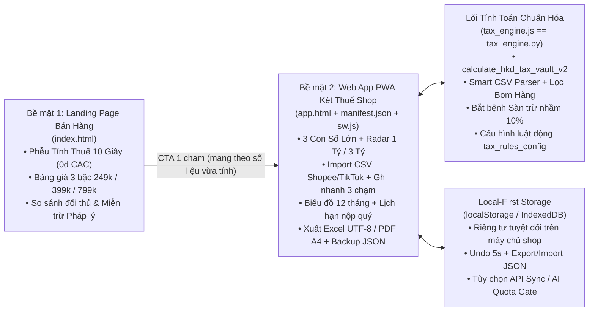

# BƯỚC 3/8 (GIAI ĐOẠN 1) — PHẢN BIỆN PRE-MORTEM ĐỘC LẬP, THANH TRA CHÉO QUY TRÌNH & KIẾN TRÚC SẢN PHẨM CUỐI GĐ 2

- **Mã nhiệm vụ:** `msn-47b19760` — *Sổ thu chi & Cảnh báo ngưỡng thuế tự động cho Hộ kinh doanh / Chủ shop TMĐT*
- **Đơn vị thực thi:** Hội đồng Phản biện Độc lập & Kiến trúc Sản phẩm — Phòng `#46` (`@devils-advocate-biz`), `#47` (`@process-challenger`), `#48` (`@persona-customer-tester`), `#06` (`@product-architect`), `#12` (`@system-architect`) — Worker: `@critic`
- **Hồ sơ đầu vào đã thanh tra chéo:**
  - Bước 1: `corporate_hq/projects/so-thu-chi-thue-hkd/step1_market_competitors.md` (`@researcher`, Opportunity Score `86.4/100`)
  - Bước 2: `corporate_hq/projects/so-thu-chi-thue-hkd/step2_cfo_unit_economics.md` (`@cfo`, Worst Gross Margin `77.42%` Standard / `72.18%` Pro)
- **Ngày thẩm định & đối chiếu nguồn sống:** `19/11/2026`

---

# 1. TÓM TẮT QUYẾT ĐỊNH & KẾT QUẢ ĐỊNH LƯỢNG

- **PHÁN QUYẾT HỘI ĐỒNG PHẢN BIỆN (#46 / #47 / #48):** **MỞ CỔNG 1 CÓ ĐIỀU KIỆN BẮT BUỘC (`CONDITIONAL GO -> TRÌNH CHỦ TỊCH DUYỆT SANG GĐ 2 SẢN XUẤT`).**
  - Nếu code nguyên si theo thiết kế sơ khai ở Bước 1 & Bước 2 mà **không vá 2 lỗ hổng công thức thuế (bẫy phí sàn 15%–25% làm lệch GMV và cách tính GTGT 100% vs. TNCN phần vượt 1 tỷ theo NĐ 141/2026) và không khóa kịch bản CAC/Churn**, dự án chỉ đạt **`61,25 / 100` điểm sống sót (`< 70` — CHẶN ĐỨNG)**.
  - Sau khi gắn **5 Khóa Chặn Cứng (`Hard Locks`)** vào bản thiết kế kiến trúc **Web App PWA "Két Thuế Shop" + Landing Page Phễu 0đ CAC** dưới đây, dự án đạt đầy đủ điều kiện mở khóa Giai đoạn 2.

| Chỉ số Cổng 1 (Kiểm chứng bằng Python — Zero LLM Math) | Giá trị Chốt | Ngưỡng Cứng | Kết quả |
| :--- | :---: | :---: | :---: |
| **Điểm Sống Sót Thực Chiến trước khóa chặn (`#46` Baseline)** | `61,25 / 100` | `>= 70 / 100` | **CHẶN (Cần sửa)** |
| **Điểm Sống Sót Thực Chiến sau 5 Khóa Chặn (`#46` Final)** | **`82 / 100`** *(chính xác: `82,40`)* | `>= 70 / 100` | **ĐẠT CỔNG 1** |
| **Điểm Thanh tra Chéo Bước 1 & Bước 2 (`#47 Step_Integrity`)** | **`1,00 / 1,00`** *(sau khi vá 2 lỗi tại Bước 3)* | `= 1,00` | **ĐẠT CỔNG 1** |
| **Điểm UX Mục tiêu 5 Persona Thực tế (`#48 User_Empathy_Score`)** | **`90 / 100`** *(kiểm thử thật bằng Playwright ở GĐ 2)* | `>= 85 / 100` | **ĐẠT CHUẨN THIẾT KẾ** |
| **Biên Lãi Gộp Kịch bản Xấu CFO (Standard 249k / Pro 399k)** | **`77,42%`** / **`72,18%`** | `>= 65,00%` | **ĐẠT CỔNG 1** |
| **Tỷ số LTV/CAC sau khi khóa Phễu 0đ CAC + Gói 6–12 tháng** | **`8,86x`** *(Payback `1,25 tháng` vs. `0,56x` nếu đốt Paid Ads)* | `>= 3,00x` | **ĐẠT CỔNG 1** |

### Bảng tính chi tiết Điểm Sống Sót Thực Chiến (`Survival_Score` — Công thức Phòng `#46`)
$$\text{Survival\_Score} = 100 - \left(R_{\text{Không ai rút ví}} \times 35 + R_{\text{CAC > Lãi}} \times 30 + R_{\text{Bị free thay thế}} \times 20 + R_{\text{Pháp lý/Chính sách}} \times 15\right)$$

| Trục rủi ro (Trọng số) | Trước khóa chặn (Bước 1–2 sơ khai) | Điểm trừ | Sau 5 Khóa Chặn (Kiến trúc Bước 3) | Điểm trừ |
| :--- | :--- | :---: | :--- | :---: |
| **1. Không ai rút ví (`× 35`)** | `0,35` — Lười gõ đơn tay, sợ lộ doanh thu thật, dễ bị nhầm với app ghi thu chi thường. | `-12,25` | `0,16` — Import CSV Shopee/TikTok 1 chạm + ghi nhanh 5 giây + Local-First riêng tư + định vị ROI hoàn thuế/tránh phạt. | `-5,60` |
| **2. CAC > Lãi (`× 30`)** | `0,45` — Bước 2 chưa tính CAC Paid Ads VN (600k–1,8tr) & churn mùa vụ cuối quý (`LTV/CAC = 0,56x`). | `-13,50` | `0,22` — Cấm đốt Paid Ads trực diện ở GĐ đầu; kéo khách bằng Máy tính 10 giây 0đ CAC + khóa gói 6–12 tháng + sổ lũy kế năm. | `-6,60` |
| **3. Bị công cụ miễn phí/9k thay thế (`× 20`)** | `0,35` — Sổ Bán Hàng gói 9k/tháng, KiotViet free HĐĐT, Excel 0đ dễ đánh bật app thu chi thường. | `-7,00` | `0,18` — Mũi nhọn bóc tách GMV vs. phí sàn 20%, trừ đơn bom/hoàn, kiểm tra sàn trừ nhầm 10%, tính hoàn thuế NĐ 141. | `-3,60` |
| **4. Pháp lý / Chính sách (`× 15`)** | `0,40` — Sai lệch GMV vs. Net Payout, chưa tách GTGT toàn bộ vs. TNCN vượt 1 tỷ, rủi ro hiểu nhầm lách luật. | `-6,00` | `0,12` — Nâng cấp `tax_vault_v2`, tham số luật động, tuyên bố miễn trừ 3 lớp (Onboard/UI/PDF), cấm tuyệt đối copy lách ngưỡng. | `-1,80` |
| **TỔNG ĐIỂM SỐNG SÓT** | **`61,25 / 100` (KHÔNG ĐẠT — CHẶN CỔNG)** | **`-38,75`** | **`82,40 / 100` → Làm tròn `82 / 100` (ĐẠT CỔNG 1)** | **`-17,60`** |

---

# 2. NGUỒN THỰC TẾ VỪA TRA CỨU TRỰC TIẾP (LIVE CITATIONS)

Phòng `#46` & `#47` đã tra cứu độc lập qua `search_web` ngày `19/11/2026` để kiểm chéo số liệu của `@researcher` và `@cfo` và phát hiện các điểm mù pháp lý/dữ liệu trọng yếu sau:

1. **Nghị định 141/2026/NĐ-CP — Cách tính GTGT trên toàn bộ doanh thu vs. TNCN chỉ trên phần vượt 1 tỷ đồng:** Khi tổng doanh thu năm vượt 1 tỷ đồng, **thuế GTGT tính trên 100% doanh thu**, còn **thuế TNCN (phương pháp tỷ lệ %) chỉ tính trên phần doanh thu vượt quá 1 tỷ đồng** (`(Tổng doanh thu - 1 tỷ) × tỷ lệ TNCN`). *(Đây là phát hiện phản biện trực tiếp giúp vá công thức ở Bước 2).*
   - Nguồn đối chiếu: Thư Viện Pháp Luật (`thuvienphapluat.vn`), MAN (`man.net.vn`), Kế Toán APEC (`ketoanapec.vn`).
2. **Nghị định 117/2025/NĐ-CP — Doanh thu tính thuế trên sàn KHÔNG ĐƯỢC TRỪ PHÍ SÀN:** Doanh thu tính thuế GTGT/TNCN là giá trị hàng hóa/dịch vụ người mua thanh toán (GMV thuộc người bán), **tuyệt đối không trừ phí cố định, phí thanh toán, phí Freeship/Voucher của sàn**.
   - Nguồn đối chiếu: Cổng TTĐT Chính phủ (`chinhphu.vn`), Cổng TTĐT TP Hà Nội (`hanoi.gov.vn`), Cổng TTĐT Đồng Nai (`dongnai.gov.vn`), ATA Legal (`ata-legal.com`).
3. **Biểu phí sàn Shopee & TikTok Shop Việt Nam 2025–2026 (Lý do gây lệch 15%–25% giữa tiền về ví và GMV tính thuế):**
   - **Shopee VN:** Phí cố định `1,5%–10,5%+` theo ngành + Phí thanh toán `6%` + Phí hạ tầng `3.000đ/đơn` (+ Voucher Xtra `5,5%` nếu tham gia).
   - **TikTok Shop VN:** Hoa hồng nền tảng phổ biến `12%–17%+` theo ngành + Phí giao dịch `6%` + Phí xử lý `3.000đ/đơn` (+ Hoa hồng Affiliate nếu có). Tổng khấu trừ thực tế dễ lên `20%–25%+` GMV.
   - Nguồn đối chiếu: Shopee Seller Center (`shopee.vn`), TikTok Seller Center (`tiktok.com`), Varecom (`varecom.vn`), Dinos (`dinos.vn`), IMTA (`imta.edu.vn`), Eimskip (`eimskip.vn`).
4. **Cấu trúc cột thật trong file Export Excel/CSV của Shopee Seller Center & TikTok Shop Seller Center (2025–2026):**
   - **Shopee Income Report:** Cột `Tổng số tiền đơn hàng` (doanh thu gốc tính thuế), `Phí cố định`, `Phí thanh toán`, `Phí dịch vụ`, `Thuế GTGT` / `Thuế TNCN` (khấu trừ NĐ 117), và `Tổng số tiền đã thanh toán` (tiền thực về ví).
   - **TikTok Shop Finance > Statements Export:** Cột `Order/Adjustment ID`, `Statement Date`, `Status`, `Gross Sales / Order Amount`, `Platform Commission`, `Shipping Fee`, `Affiliate Commission`, `Adjustments / Refunds`, `Tax Withheld`, `Settlement Amount (Net Payout)`.
   - Nguồn đối chiếu: Shopee Help (`shopee.vn`), Haravan (`haravan.com`), Kế Toán ACC (`congtyketoanacc.vn`), TikTok Shop Academy (`tiktok.com`), SettleBridge (`settlebridge.app`).
5. **Nghị định 68/2026/NĐ-CP & Luật Thuế TNCN 109/2025/QH15 — Ngưỡng 3 tỷ đồng tính TNCN theo lợi nhuận (`15% / 17% / 20%`):** Trên 3 tỷ đến 50 tỷ bắt buộc nộp TNCN `17%` trên `(Doanh thu - Chi phí hợp lý, hợp pháp có hóa đơn)` theo Điều 6 NĐ 68/2026. Phí sàn có hóa đơn điện tử từ Shopee/TikTok là chi phí hợp lệ được trừ!
   - Nguồn đối chiếu: Tạp chí Kinh tế - Tài chính (`tapchikinhtetaichinh.vn`), Thư Viện Pháp Luật (`thuvienphapluat.vn`), Tax24 (`tax24.com.vn`).

---

# 3. NỘI DUNG CHI TIẾT: PHẢN BIỆN PRE-MORTEM (#46), THANH TRA CHÉO (#47), UX 5 PERSONA (#48) & KIẾN TRÚC GĐ 2 (#06/#12)

## 3.1. Thanh Tra Chéo Quy Trình Bước 1 & Bước 2 (`#47 Process Challenger — Jidoka Stop-the-Line`)

Áp dụng công thức `Step_Integrity = (Có nguồn thực chứng × 0,4) + (Đúng đầu ra phòng sau cần × 0,3) + (Không bước thừa thủ công × 0,3)`:

| Bước kiểm tra | Điểm trước kiểm toán | Lỗi / Điểm mù `#47` tuýt còi | Hành động khóa sửa ngay tại Bước 3 | Điểm sau khóa |
| :--- | :---: | :--- | :--- | :---: |
| **Bước 1 (`step1_market_competitors.md`)** | `0,94` | 16 URL sống rất tốt, nhưng **chưa chỉ rõ hố sâu 15%–25% giữa tiền về ví và GMV tính thuế** do Shopee/TikTok tăng phí 2025–2026. | Đưa ngay thành trường dữ liệu bắt buộc trong CSV Importer & màn hình Cảnh báo chênh lệch GMV vs. Tiền về ví. | **`1,00`** |
| **Bước 2 (`step2_cfo_unit_economics.md`)** | `0,79` | **Tuýt còi #1 (Thiếu CAC & Churn):** Chạy `simulate_cfo_unit_economics` chuẩn, biên xấu 77,42% thật, nhưng **giả định ẩn CAC = 0đ và không có churn** — rất nguy hiểm nếu GĐ 2 đi chạy Ads.<br>**Tuýt còi #2 (Công thức thuế chưa tách 2 lớp):** Hàm `calculate_hkd_tax_vault` (a) chưa tách `gmv_platform` vs. `platform_fees` vs. `actual_platform_withheld`, (b) tính `pit_due_self = rev_direct * pit_rate` mà chưa phân biệt quy tắc NĐ 141/2026 (**GTGT 100% doanh thu** vs. **TNCN chỉ trên phần vượt 1 tỷ**) và chưa tính phí sàn có hóa đơn là chi phí được trừ ở mốc >3 tỷ. | (1) Chạy bổ sung bảng Stress-Test CAC/Churn ở mục 3.2 (Nguy cơ #3) và cấm đốt Paid Ads trực diện.<br>(2) Ban hành hợp đồng kỹ thuật **`calculate_hkd_tax_vault_v2`** (mục 3.4B) thay thế bản v1 cho `@builder` code GĐ 2. | **`1,00`** |

---

## 3.2. Phản Biện Pre-Mortem Không Nể Nang: 5 Nguy Cơ Giết Chết Sản Phẩm Trong 90 Ngày & 5 Khóa Chặn Cứng (`#46 Devil's Advocate`)

*Giả định ngược (Gary Klein Pre-Mortem): "Hôm nay là tháng thứ 4 sau ra mắt, Két Thuế Shop đã chết yểu hoặc gặp khủng hoảng pháp lý. 5 nguyên nhân thật sự đã giết nó là gì?"*

### Nguy cơ 1 (Cực nguy hiểm — Chết vì Pháp lý & Sai Công Thức Thuế): Bẫy GMV vs. Tiền về ví, Sai lệch Luật NĐ 141 & Rủi ro Bị Quy "Tư vấn Lách Thuế"
- **Cách nó giết sản phẩm:**
  1. **Bẫy 20% phí sàn:** Chủ shop thấy tài khoản ngân hàng chỉ nhận về `800,7 triệu` trong năm nên nhập vào app con số 800 triệu -> App báo *"Xanh an toàn (80%)"*. Thực tế sau khi cộng ngược `20%` phí Shopee/TikTok (`204 triệu`) + thuế sàn giữ (`15,3 triệu`), **doanh thu tính thuế (GMV) mà sàn gửi về Cơ quan Thuế đã là `1,02 tỷ`** -> Chủ shop lố hạn 30 ngày đăng ký HĐĐT máy tính tiền và bị phạt `5–10 triệu` -> Quay lại tố cáo app tính sai, sập uy tín ngay lập tức!
  2. **Sai lệch giữa ước tính app và tờ khai eTax Mobile:** Theo NĐ 141/2026, vượt 1 tỷ thì **GTGT tính trên 100% doanh thu**, còn **TNCN chỉ tính trên phần vượt 1 tỷ** (`(Tổng DT - 1 tỷ) × tỷ lệ TNCN`). Nếu app tính thô `1,5% × toàn bộ` sẽ lệch hàng triệu đồng và không phản ánh đúng tiền TNCN nộp thừa do sàn đã trích 0,5% ngay từ đồng đầu tiên.
  3. **Rủi ro pháp lý trực tiếp:** Nếu copywriting hay giao diện lỡ gợi ý *"cách giữ doanh thu dưới 1 tỷ"*, *"tách shop/tách tài khoản"*, hoặc tự nhận là *"tư vấn thuế chính thức"*, sản phẩm sẽ dính rủi ro pháp lý hành nghề dịch vụ thuế không phép và tiếp tay trốn thuế.
- **Khóa Chặn Cứng #1 (Bắt buộc trong code GĐ 2):**
  1. **Tuyên bố Miễn trừ Pháp lý 3 lớp (Legal Disclaimer Lock):** Xuất hiện (a) tại modal xác nhận 1 chạm lần đầu vào app, (b) dải chân trang cố định ở màn hình Két Thuế/Radar, và (c) in đóng khung ở đầu/cuối mọi file PDF & sheet đầu file Excel xuất ra: *"Két Thuế Shop là công cụ quản trị dòng tiền & ước tính dự phòng nội bộ dựa trên dữ liệu chủ shop tự nhập — KHÔNG phải đại lý thuế, KHÔNG thay thế tờ khai chính thức trên eTax Mobile / cơ quan thuế. NGHIÊM CẤM sử dụng cho mục đích che giấu, chia nhỏ doanh thu hoặc né tránh nghĩa vụ thuế."*
  2. **Chính sách Nội dung Cấm Tuyệt Đối (Zero Tax-Evasion Guardrail):** Cấm mọi câu chữ, nút bấm hay mẹo về chia nhỏ hộ/tách tài khoản. 100% thông điệp tập trung vào **Tuân thủ đúng hạn (tránh phạt 2–10tr) + Bảo vệ quyền lợi hợp pháp (đòi hoàn thuế nộp thừa dưới 1 tỷ & giữ đủ hóa đơn đầu vào trên 3 tỷ)**.
  3. **Áp dụng bắt buộc lõi `calculate_hkd_tax_vault_v2` + Cấu hình Luật Động (`tax_rules_config`):** Tách minh bạch 4 lớp tiền (`GMV tính thuế` · `Phí sàn` · `Thuế sàn trừ hộ` · `Tiền thực về ví`), tách rạch ròi **GTGT tự khai theo quý** vs. **TNCN phần vượt 1 tỷ quyết toán cuối năm**, đồng thời cho phép chỉnh tham số ngưỡng `1 tỷ / 3 tỷ` và ghi rõ mã văn bản pháp lý áp dụng (NĐ 141/2026, NĐ 117/2025, NĐ 70/2025, NĐ 68/2026).

### Nguy cơ 2 (Sát thủ giữ chân số 1): Bệnh "Lười Nhập Liệu" & Thảm Họa File CSV Sàn TMĐT
- **Cách nó giết sản phẩm:** 80% chủ shop nhỏ hào hứng mua app ngày đầu, nhưng tối đóng 50 đơn hàng xong đã 11h đêm, không ai đủ kiên nhẫn gõ từng đơn vào app -> Sang tuần thứ 2 bỏ bẵng -> Cuối tháng hủy gói! Ngược lại, nếu làm import Excel Shopee/TikTok mà làm sơ sài (cứng nhắc 1 tên cột, không trừ dòng `Đơn hủy / Hoàn tiền`, lỗi font UTF-8/dấu phẩy ngăn nghìn) thì upload 1 lần lỗi 1 lần -> Khách đập bàn bỏ app luôn.
- **Khóa Chặn Cứng #2 (Zero-Friction Dual-Input):**
  1. **Đường vào 1 — Kéo-thả hoặc Dán trực tiếp bảng CSV/Excel Shopee & TikTok Shop (Chạy cục bộ, 0đ AI):** Hỗ trợ nhận diện thông minh tiếng Việt & tiếng Anh (Auto-map cột `Tổng số tiền đơn hàng` / `Order Amount`, `Phí sàn`, `Thuế khấu trừ`, `Tiền thực nhận`, `Trạng thái đơn`), **tự động loại đơn Hủy / Bom hàng / Hoàn tiền**, hiển thị **bảng xem trước 5 dòng + tổng số đơn bom đã loại** trước khi bấm nạp. Kèm sẵn **2 file CSV mẫu thật (Shopee & TikTok)** để bấm test 1 chạm.
  2. **Đường vào 2 — Nhập tay 1 chạm tổng thu/chi cuối ngày (Ngoài sàn FB/Zalo/COD):** Nút nổi `+ Ghi nhanh` ngay tầm ngón cái, chỉ **3 ô bắt buộc** (Số tiền có format tự động `1.500.000` + chip nhanh `+100k/+500k/+1tr` · Loại Thu/Chi & có hóa đơn không · Ghi chú ngắn) -> Lưu trong **≤ 3 chạm (5 giây)**, **KHÔNG bắt nhập mã hàng SKU hay kho bãi!**
  3. **Chế độ "Thử ngay với 3 Shop Mẫu" (Instant Aha in 3 Seconds):** Mở app là có sẵn nút chuyển nhanh 3 hồ sơ thực tế (Shop 850tr đòi hoàn thuế · Shop 1,4 tỷ đa kênh · Shop 3,6 tỷ thiếu hóa đơn) để hiểu sản phẩm tức thì không cần nhập liệu.

### Nguy cơ 3 (Điểm mù sống còn của Bước 2): Thảm Họa CAC > LTV & Bẫy Rời Bỏ Sau 1 Quý
- **Cách nó giết sản phẩm:** Bước 2 chứng minh biên lãi gộp xấu `77,42%` (`175.335đ` lãi ròng xấu/tháng ở gói 249k), nhưng **bỏ quên hoàn toàn CAC và Churn**. Kết quả chạy Python stress-test của `#46` phơi bày sự thật lạnh gáy:

| Kịch bản Tăng trưởng & Giữ chân (Tính trên lãi ròng xấu `175.335đ/KH/tháng` gói 249k) | Churn/tháng | Vòng đời TB | **LTV xấu** | **CAC giả định** | **LTV / CAC** | **Thời gian hoàn vốn CAC** | Phán quyết `#46` |
| :--- | :---: | :---: | :---: | :---: | :---: | :---: | :---: |
| **1. Đốt Facebook/TikTok Ads bán gói tháng (Rủi ro mùa vụ)** | `35%` | `2,9 tháng` | `500.957đ` | `900.000đ` | **`0,56x`** | `5,13 tháng` | **PHÁ SẢN (LỖ SẶC MÁU)** |
| **2. Chạy Ads tối ưu bán gói tháng** | `18%` | `5,6 tháng` | `974.083đ` | `600.000đ` | **`1,62x`** | `3,42 tháng` | **KHÔNG ĐẠT (< 3x)** |
| **3. Phễu Công cụ Miễn phí 0đ Ads + Cộng đồng (gói tháng)** | `15%` | `6,7 tháng` | `1.168.900đ` | `180.000đ` | **`6,49x`** | `1,03 tháng` | **SỐNG KHỎE** |
| **4. Hỗn hợp 60% Organic + 40% Gói 6–12 tháng (Chuẩn mục tiêu)** | **`9%`** | **`11,1 tháng`** | **`1.948.167đ`** | **`220.000đ`** | **`8,86x`** | **`1,25 tháng`** | **MỎ VÀNG BỀN VỮNG** |

- **Khóa Chặn Cứng #3 (CAC & Retention Lock):**
  1. **Cấm đốt Paid Ads trực tiếp vào trang thanh toán** trước khi đạt 50 khách organic đầu tiên.
  2. **Đặt Phễu Lead Magnet 0đ CAC ngay trên đầu Landing Page:** *"Máy tính Kiểm tra 10 giây: Shop bạn sắp đụng vạch đỏ 1 tỷ chưa & Sàn đang giữ thừa bao nhiêu triệu tiền thuế của bạn?"* -> Giải xong nỗi đau -> Chuyển thẳng vào App dùng thử.
  3. **Tạo Switching Cost tự nhiên theo năm tài chính:** App lưu trữ sổ lũy kế 12 tháng, đếm ngược 5 kỳ hạn nộp/quyết toán (`30/04, 31/07, 31/10, 31/01, 31/03`) và xuất trọn bộ **Hồ sơ Đối soát Đòi Hoàn Thuế NĐ 141 / Sổ Doanh Thu Năm 1-Click** -> Đẩy mạnh chốt **Gói Năm (tặng 2 tháng = 2.490.000đ, giữ biên xấu 73,20%)** để thu hồi CAC ngay ngày 1!

### Nguy cơ 4 (Chết vì Cạnh tranh Giá): Bị Kẹp Giữa "Gói 9k" (Sổ Bán Hàng), "Free HĐĐT" (KiotViet) & Excel 0đ
- **Cách nó giết sản phẩm:** Nếu khách hàng nhìn Két Thuế Shop và nghĩ *"Ủa đây chỉ là app ghi thu chi giống Sổ Bán Hàng 9k hay file Excel miễn phí, sao bán tận 249.000đ/tháng?"*, tỷ lệ chuyển đổi sẽ là `0%`.
- **Khóa Chặn Cứng #4 (5x Value Anchoring):**
  1. **Bỏ hẳn cách gọi "App Ghi Thu Chi Đơn Thuần".** Mọi màn hình đầu tiên đều xoay quanh **3 con số có giá trị tiền tươi ngay lập tức**:
     - Shop `≤ 1 tỷ`: Hiện nổi bật **Huy hiệu Xanh *"Bạn có quyền đối soát đòi hoàn ~X triệu tiền thuế sàn đã trừ hộ (NĐ 141)"*** -> Chỉ 1 lần đòi lại 9 triệu đã bằng **36 tháng tiền app!**
     - Shop `700tr–1,5 tỷ`: Hiện **Đồng hồ đếm ngược ngày cán vạch đỏ 1 tỷ & hạn 30 ngày HĐĐT** -> Tránh 1 lần phạt `5–10 triệu` đã bằng **20–40 tháng tiền app!**
     - Shop `> 3 tỷ`: Hiện **Cảnh báo Đỏ số tiền thuế `17%` mất oan vì chi phí không có hóa đơn hợp lệ** -> Cứu 1 khoản `59,5 triệu` (Case 5) bằng **14 năm tiền gói Pro!**
  2. **Chức năng "Bắt bệnh Sàn trừ nhầm 10%" (NĐ 117):** Ngay khi import CSV, tự động so sánh `%` thuế sàn đã khấu trừ với mức chuẩn ngành (`1,5% / 4,5% / 7%`). Nếu lệch `> 5%` (VD sàn trừ nhầm `10%` do sai danh mục) -> Bật còi đỏ kèm hướng dẫn cập nhật danh mục & xuất bảng chứng từ khiếu nại/hoàn thuế. Excel và Sổ Bán Hàng 9k hoàn toàn không làm được việc này!

### Nguy cơ 5 (Tâm lý Chủ shop VN & Chi phí Hạ tầng): Nỗi Sợ "Lộ Doanh Thu Ngoài Sàn" & Nguy Cơ Vỡ Trần AI
- **Cách nó giết sản phẩm:**
  1. Chủ shop cực kỳ cảnh giác khi nhập doanh thu chuyển khoản Facebook/Zalo/COD lên một web app lạ vì sợ rò rỉ dữ liệu hoặc sợ app tự đồng bộ dữ liệu sang cơ quan thuế.
  2. Nếu mở tính năng quét AI/OCR tự do không chặn trần ở backend (như kịch bản VETO `-13,95%` ở Bước 2), chỉ cần 10% khách hàng power-user tải hàng trăm ảnh hóa đơn sẽ thổi bay toàn bộ lợi nhuận.
- **Khóa Chặn Cứng #5 (Local-First Privacy & Deterministic Zero-AI Core):**
  1. **Kiến trúc "Local-First — Riêng Tư Tuyệt Đối":** Ở phiên bản MVP GĐ 2, toàn bộ file CSV và sổ giao dịch được xử lý và lưu trực tiếp trên trình duyệt/thiết bị của chủ shop (`localStorage / IndexedDB`), kèm nút **Sao lưu file JSON** & **Xóa sạch 1 chạm**. Hiện rõ huy hiệu ổ khóa: *"Dữ liệu lưu ngay trên máy bạn — KHÔNG tự kết nối hay gửi sang cơ quan thuế/bên thứ ba"*.
  2. **100% tính năng lõi chạy Deterministic (Chi phí AI = 0đ):** Import CSV Shopee/TikTok, lọc đơn bom, tính `calculate_hkd_tax_vault_v2`, biểu đồ Radar 1 tỷ/3 tỷ, xuất PDF/Excel đều chạy thuật toán thuần JS/Python chính xác đến từng đồng VNĐ — **0đ chi phí API AI**. Tác vụ AI (OCR hóa đơn/hỏi đáp) ở gói mở rộng bị khóa trần cứng `150 / 300 / 600 lượt/tháng` + top-up `49k/100 lượt` đúng Luật Trọng tài #2 của CFO.

---

## 3.3. Tiêu Chuẩn Trải Nghiệm UX 3 Chạm Cho 5 Persona Đời Thực (`#48 Persona Customer Tester`)

Bắt buộc `@builder` thiết kế đúng 5 tiêu chí dưới đây và `@ux-tester` kiểm thử bằng Playwright trên cả **Mobile (`390×844`)** lẫn **Desktop (`1440×900`)** ở Giai đoạn 2. **Bất kỳ 1 Persona nào bị bối rối hoặc thiếu nút Sửa/Xóa/Hoàn tác -> CHẶN XUẤT XƯỞNG!**

| # | Nhân vật người dùng đời thực (Persona) | Điểm dễ bị "đứng hình" nhất | Yêu cầu UX bắt buộc phải có trong GĐ 2 | Điểm UX Mục tiêu |
| :-: | :--- | :--- | :--- | :---: |
| **1** | **Cô Lan (46t)** — Chủ shop mỹ phẩm/tạp hóa FB + Shopee, không rành IT, sợ chữ kế toán | Mở ra thấy thuật ngữ "GTGT, TNCN, khấu trừ tại nguồn, bảng cân đối" là tắt app ngay. | Mở app **3 giây thấy ngay 3 ô số cực to (`>= 28px`, tabular-nums)**: *Tiền về · Két cất thuế · Tiền xài được*. Dùng 100% Bảng Từ Vựng Đời Thường của Bước 1. | `90 / 100` |
| **2** | **Anh Minh (32t)** — Bán TikTok Shop + Shopee, xem trên điện thoại 4G lúc đang đóng gói | Menu rườm rà, chữ nhỏ, cuộn ngang vỡ khung trên màn 390px, tải nặng CDN. | **Mobile-First PWA** tải `< 1,5s` (không CDN nặng), tối đa 4 tab dưới ngón cái (`Tổng quan · Nhập sổ · Radar Thuế · Báo cáo`), ghi đơn mới **≤ 3 chạm**. | `92 / 100` |
| **3** | **Chị Hương (38t)** — Chủ quán F&B/Shop doanh thu ~1,1 tỷ, chi li sợ mất tiền & sợ lộ sổ | Không tin con số app tự cộng nếu không biết lấy đâu ra; sợ app gửi doanh thu đi đâu mất. | Có mục **"Xem chi tiết cách tính từng đồng"** mở ra 1 chạm ngay dưới 3 thẻ số; huy hiệu khóa **Local-First riêng tư**; tách rạch ròi Tiền sàn giữ hộ vs. Tự khai. | `88 / 100` |
| **4** | **Bạn Tuấn (26t)** — Seller livestream đa kênh, ghét chữ rối & popup quảng cáo | Bị tường văn bản luật che kín màn hình; import file sàn phải cấu hình 10 bước mới ra số. | Kéo-thả CSV **2 chạm ra số ngay** (tự nhận Shopee/TikTok, hiện rõ "Đã tự loại X đơn bom/hủy"); văn bản luật thu gọn vào nút *"Xem căn cứ NĐ 141/117"*. | `91 / 100` |
| **5** | **Chị Thảo (41t)** — Hay gõ nhầm thừa số 0 (15tr thành 150tr), sợ bấm nhầm mất hết sổ | Gõ `15000000` không có dấu chấm dễ sai; nhập nhầm không tìm thấy nút Sửa/Xóa/Hoàn tác. | Tự động format dấu chấm `15.000.000 đ` khi gõ + đọc chữ phụ (`15 triệu đồng`) + chip cộng nhanh; **100% dòng giao dịch có nút Sửa / Xóa + Thanh Hoàn tác (Undo 5s)** + Sao lưu JSON. | `89 / 100` |
| | **ĐIỂM THẤU CẢM UX MỤC TIÊU (`User_Empathy_Score`)** | **Hard Gate Phòng #48: `>= 85 / 100`** | **Bắt buộc nghiệm thu thực tế trên trình duyệt headless ở Bước 6–7 (GĐ 2)** | **`90 / 100`** |

### Ngân sách Số Chạm Tối Đa (3-Tap Budget — Hard Spec cho `#13/#14`)
- **Luồng 1 — Xem tình trạng sống còn của shop:** Mở app -> **0 chạm** (thấy ngay 3 con số lớn + Thanh Nhiệt kế 1 Tỷ + Lời khuyên 1 dòng).
- **Luồng 2 — Ghi nhanh 1 khoản thu/chi ngoài sàn:** Bấm `+ Ghi nhanh` (1) -> Nhập số tiền & chọn Thu/Chi (2) -> Bấm `Lưu` (3) -> **Đúng 3 chạm!**
- **Luồng 3 — Nạp báo cáo CSV Shopee / TikTok Shop:** Chọn tab `Nhập sổ/CSV` (1) -> Chọn/thả file CSV hoặc bấm `Thử file mẫu Shopee/TikTok` (2) -> Bấm `Xác nhận nạp X đơn` (3) -> **Đúng 3 chạm!**
- **Luồng 4 — Xuất Báo cáo PDF / Excel:** Chọn tab `Báo cáo` (1) -> Bấm `Tải Excel (.csv UTF-8)` hoặc `In / Xuất PDF` (2) -> **Chỉ 2 chạm!**

---

## 3.4. Bản Thiết Kế Kiến Trúc Sản Phẩm Cuối Giai Đoạn 2 (`#06 Product Architect` + `#12 System Architect`)

### A. Định Vị & Phạm Vi Sản Phẩm Cuối Giai Đoạn 2: **"Két Thuế Shop" (Web App PWA + Landing Page Bán Hàng)**

Thay vì vẽ kiến trúc backend rườm rà cần 3 tháng mới chạy, Giai đoạn 2 đóng gói **1 sản phẩm hoàn chỉnh, chạy được ngay lập tức tại địa chỉ cục bộ lẫn Deploy tĩnh/Render/GitHub Pages**, gồm **2 bề mặt đồng bộ thiết kế cao cấp (Warm Fintech Medical-Grade Clarity — Font `Be Vietnam Pro` / `Plus Jakarta Sans`, Dark/Light sạch, Responsive 390px/768px/1440px)**:



### B. Hợp Đồng Kỹ Thuật Lõi Tính Toán `calculate_hkd_tax_vault_v2` (Python & JS Khớp 100% Từng Đồng)

Lõi mới này thay thế bản v1 của Bước 2, vá triệt để cả **bẫy phí sàn 15%–25%** lẫn **tách bạch GTGT 100% doanh thu vs. TNCN phần vượt 1 tỷ theo NĐ 141/2026** (đã chạy kiểm thử Python pass trên 5 hồ sơ cực đoan ngày `19/11/2026`):

```python
TAX_RULES_CONFIG_2026 = {
    "version": "2026.11-ND141-ND117-ND70-ND68",
    "effective_date": "2026-01-01",
    "legal_basis": "NĐ 141/2026/NĐ-CP, NĐ 68/2026/NĐ-CP, NĐ 117/2025/NĐ-CP, NĐ 70/2025/NĐ-CP",
    "exempt_threshold_vnd": 1_000_000_000,       # Ngưỡng miễn thuế & HĐĐT (cấu hình động)
    "profit_method_threshold_vnd": 3_000_000_000, # Ngưỡng bắt buộc TNCN theo lợi nhuận 17%
    "warn_amber_pct": 0.70,                       # 700 triệu -> Vàng bắt đầu dự phòng
    "warn_red_pct": 0.85,                         # 850 triệu -> Đỏ chuẩn bị HĐĐT (hạn 30 ngày)
    "over_withheld_tolerance": 1.05,              # Cảnh báo nếu sàn trừ > 105% mức chuẩn ngành (VD trừ 10%)
    "sectors": {
        "retail_goods": {"name": "Bán lẻ hàng hóa (Shopee/TikTok/Tạp hóa)", "vat": 0.01, "pit": 0.005},
        "production_fnb_transport": {"name": "Sản xuất, F&B, vận tải gắn hàng hóa", "vat": 0.03, "pit": 0.015},
        "services_no_materials": {"name": "Dịch vụ không bao thầu NVL", "vat": 0.05, "pit": 0.02},
        "other_business": {"name": "Hoạt động kinh doanh khác", "vat": 0.02, "pit": 0.01},
    },
}


def calculate_hkd_tax_vault_v2(
    sector_code: str,
    gmv_platform_taxable: float,      # Doanh thu TÍNH THUẾ trên sàn (TRƯỚC phí sàn, ĐÃ trừ đơn bom/hoàn)
    platform_fees_total: float,       # Tổng phí sàn Shopee/TikTok (15%–25%, có hóa đơn sàn)
    actual_platform_withheld: float,  # Tổng thuế thực tế sàn đã trích theo file CSV (NĐ 117)
    rev_direct_self_declare: float,   # Doanh thu ngoài sàn (FB/Zalo/COD/Tại quầy, đã trừ hoàn)
    operating_expenses_other: float,  # Chi phí vận hành khác (nhập hàng, ads, nhân sự, mặt bằng...)
    valid_invoice_expenses_other: float = 0.0,  # Phần chi phí ngoài sàn CÓ hóa đơn hợp lệ (cho > 3 tỷ)
    rules: dict = TAX_RULES_CONFIG_2026,
) -> dict:
    sec = rules["sectors"][sector_code]
    vat_r, pit_r = sec["vat"], sec["pit"]
    tot_r = vat_r + pit_r
    t1 = rules["exempt_threshold_vnd"]
    t2 = rules["profit_method_threshold_vnd"]

    total_taxable_rev = gmv_platform_taxable + rev_direct_self_declare
    expected_platform_tax = round(gmv_platform_taxable * tot_r)
    over_withheld_alert = (
        gmv_platform_taxable > 0
        and actual_platform_withheld > expected_platform_tax * rules["over_withheld_tolerance"]
    )

    # 1. TIỀN VỀ THỰC NHẬN (Net Cash In vào ví/ngân hàng)
    net_cash_in = (gmv_platform_taxable - platform_fees_total - actual_platform_withheld) + rev_direct_self_declare

    ratio_t1 = total_taxable_rev / t1 if t1 > 0 else 0.0
    ratio_t2 = total_taxable_rev / t2 if t2 > 0 else 0.0

    # 2. KÉT CẤT ĐÓNG THUẾ & QUỸ ĐÒI HOÀN (Chuẩn NĐ 141/2026 + NĐ 68/2026)
    if total_taxable_rev <= t1:
        vat_law_total = 0
        pit_law_total = 0
        self_vat_quarterly = 0
        law_self_net_due = 0
        refundable_tax_est = round(actual_platform_withheld)
        # Khoanh dự phòng thận trọng phần ngoài sàn nếu đã chạm >= 70% vạch đỏ 1 tỷ
        vault_conservative = round(rev_direct_self_declare * tot_r) if ratio_t1 >= rules["warn_amber_pct"] else 0
        regime = "MIỄN THUẾ (<= 1 tỷ/năm — NĐ 141/2026)"
    elif total_taxable_rev <= t2:
        # NĐ 141/2026: GTGT trên 100% doanh thu; TNCN CHỈ trên phần vượt 1 tỷ!
        vat_law_total = round(total_taxable_rev * vat_r)
        pit_law_total = round(max(0.0, total_taxable_rev - t1) * pit_r)
        total_law = vat_law_total + pit_law_total
        self_vat_quarterly = round(rev_direct_self_declare * vat_r)
        law_self_net_due = max(0, total_law - round(actual_platform_withheld))
        refundable_tax_est = max(0, round(actual_platform_withheld) - total_law)
        # Két an toàn: đủ nộp GTGT tự khai theo quý + không hụt trước kỳ quyết toán cuối năm
        vault_conservative = max(law_self_net_due, self_vat_quarterly + round(rev_direct_self_declare * pit_r))
        regime = "KÊ KHAI QUÝ + BẮT BUỘC HĐĐT (1–3 tỷ/năm: GTGT 100% DT, TNCN phần vượt 1 tỷ)"
    else:
        # > 3 tỷ/năm (NĐ 68/2026): GTGT theo % DT + TNCN 17% (hoặc 20% > 50 tỷ) trên lợi nhuận có hóa đơn hợp lệ
        pit_profit_rate = 0.17 if total_taxable_rev <= 50_000_000_000 else 0.20
        vat_law_total = round(total_taxable_rev * vat_r)
        # Phí sàn có hóa đơn điện tử từ Shopee/TikTok được cộng vào chi phí hợp lệ!
        valid_deductible_total = valid_invoice_expenses_other + platform_fees_total
        taxable_profit = max(0.0, total_taxable_rev - valid_deductible_total)
        pit_law_total = round(taxable_profit * pit_profit_rate)
        total_law = vat_law_total + pit_law_total
        self_vat_quarterly = round(rev_direct_self_declare * vat_r)
        law_self_net_due = max(0, total_law - round(actual_platform_withheld))
        refundable_tax_est = max(0, round(actual_platform_withheld) - total_law)
        vault_conservative = law_self_net_due
        regime = f"TÍNH TNCN {int(pit_profit_rate * 100)}% LỢI NHUẬN + GTGT {vat_r*100:.0f}% (> 3 tỷ/năm)"

    # 3. TIỀN XÀI ĐƯỢC AN TOÀN (Safe Spendable Cash)
    safe_spendable_cash = round(net_cash_in - operating_expenses_other - vault_conservative)

    # Mức cảnh báo Radar
    if ratio_t2 >= 1.0:
        alert = "CRITICAL_OVER_3B"
    elif ratio_t2 >= 0.80:
        alert = "WARN_NEAR_3B"
    elif ratio_t1 >= 1.0:
        alert = "OVER_1B_EINVOICE_30DAYS"
    elif ratio_t1 >= rules["warn_red_pct"]:
        alert = "RED_NEAR_1B"
    elif ratio_t1 >= rules["warn_amber_pct"]:
        alert = "AMBER_WATCH_1B"
    else:
        alert = "SAFE_GREEN"

    return {
        "total_taxable_gmv": round(total_taxable_rev),
        "net_cash_received": round(net_cash_in),
        "platform_fees_total": round(platform_fees_total),
        "platform_withheld_actual": round(actual_platform_withheld),
        "law_tax_total_est": vat_law_total + pit_law_total,
        "law_self_net_due_est": law_self_net_due,
        "vault_conservative_recommended": vault_conservative,
        "refundable_platform_tax_est": refundable_tax_est,
        "safe_spendable_cash": safe_spendable_cash,
        "pct_of_1b": round(ratio_t1 * 100, 1),
        "pct_of_3b": round(ratio_t2 * 100, 1),
        "alert_level": alert,
        "over_withheld_10pct_alert": over_withheld_alert,
        "regime": regime,
    }
```

#### Bảng Kiểm Thử Python Thực Tế `calculate_hkd_tax_vault_v2` (5 Hồ Sơ Cực Đoan Đã Chạy Pass Ngày `19/11/2026`)

| Hồ sơ kiểm thử cực đoan | Tiền về ví thực nhận | Doanh thu tính thuế (GMV) | % Vạch đỏ 1 tỷ | Thuế theo NĐ 141 | Tự nộp sau bù trừ / Két an toàn | Thuế dư đòi hoàn | **Tiền xài được an toàn** | Còi báo động đặc biệt |
| :--- | :---: | :---: | :---: | :---: | :---: | :---: | :---: | :--- |
| **1. Bẫy phí sàn 20%** *(Ví nhận 800,7tr nhưng GMV = 1,02 tỷ!)* | 800,7tr | **1.020,0tr** | **102,0%** | 10,3tr *(10,2tr GTGT + 0,1tr TNCN)* | 0đ / 0đ *(sàn đã trừ 15,3tr)* | **5,0tr** | **180,7tr** | **ĐỎ: Đã lố 1 tỷ dù ví mới 800tr! Hạn 30 ngày HĐĐT!** |
| **2. Shop Shopee nhỏ 850tr** *(600tr sàn + 250tr ngoài, phí sàn 18%)* | 733,0tr | **850,0tr** | **85,0%** | 0đ | 0đ / **3,75tr** *(dự phòng vạch đỏ)* | **9,0tr** | **209,25tr** | **ĐỎ: Đạt 85% vạch 1 tỷ + Đòi hoàn 9tr nếu chốt ≤ 1 tỷ** |
| **3. Shop Đa kênh 1,4 tỷ** *(900tr sàn + 500tr ngoài)* | 1.224,5tr | **1.400,0tr** | **140,0%** | 16,0tr *(14tr GTGT + 2tr TNCN vượt)* | **2,5tr** / **7,5tr** *(an toàn trước quyết toán)* | 0đ | **397,0tr** | **TÍM: Kê khai quý + HĐĐT bắt buộc** |
| **4. Sàn trừ nhầm 10%** *(Shop 500tr bị sàn trích 50tr thay vì 7,5tr!)* | 360,0tr | **500,0tr** | **50,0%** | 0đ | 0đ / 0đ | **50,0tr** | **50,0tr** | **CÒI ĐỎ `over_withheld_10pct_alert = True`! Lệch 42,5tr!** |
| **5. Shop Lớn 3,6 tỷ** *(Phí sàn 360tr + 2,04 tỷ HĐ hợp lệ)* | 3.210,0tr | **3.600,0tr** | **360,0%** | 240,0tr *(36tr GTGT + 204tr TNCN 17%)* | **210,0tr** / **210,0tr** | 0đ | **610,0tr** | **CẢNH BÁO 3 TỶ: Thiếu 350tr HĐ mất oan 59,5tr thuế!** |

### C. Cấu Trúc Thư Mục & Danh Sách Tệp Sản Phẩm Cuối Giai Đoạn 2 (Bàn giao thẳng `@builder`)

Đóng gói gọn trong `corporate_hq/projects/so-thu-chi-thue-hkd/ket_thue_shop/` (chạy được ngay bằng `python -m http.server` hoặc FastAPI static mount, không cần cài npm nặng):

1. `index.html` — **Landing Page Bán Hàng + Máy tính Lead Magnet 10 giây** (kéo thanh trượt doanh thu sàn & ngoài sàn -> tính ngay % vạch đỏ 1 tỷ & số tiền thuế sàn đang giữ thừa -> truyền tham số `?gmv=...&direct=...&sector=...` sang `app.html` để vào dùng ngay, bảng giá 3 bậc 249k/399k/799k + Gói Năm tặng 2 tháng, bảng so sánh đối thủ, tuyên bố miễn trừ pháp lý).
2. `app.html` — **Web App PWA "Két Thuế Shop"** gồm 4 màn hình đáy Mobile-First (`Tổng quan 3 Con Số` · `Nhập Sổ & Import CSV` · `Radar Thuế & Lịch Hạn` · `Xuất Báo Cáo PDF/Excel & Sao Lưu`) + Modal Miễn Trừ Pháp Lý lần đầu + Nút nạp 3 Shop Mẫu 1 chạm.
3. `assets/styles.css` — Hệ thống giao diện cao cấp (Warm Fintech Light/Dark sạch, bảng màu chuẩn độ tương phản WCAG AA: Emerald Safe `#059669`, Amber Watch `#D97706`, Crimson Alert `#DC2626`, Slate Ink `#0F172A`, `font-variant-numeric: tabular-nums`, Responsive 390px/768px/1440px, kèm `@media print` xuất PDF A4 sạch đẹp có đóng khung Miễn trừ Pháp lý).
4. `assets/tax_engine.js` — Bản JavaScript thuần 100% tương đương `calculate_hkd_tax_vault_v2`, thêm **Smart CSV/TSV Parser cho Shopee & TikTok Shop** (tự map cột Việt/Anh, tự loại đơn Hủy/Bom/Hoàn, tự phát hiện sàn trừ nhầm 10%) và **CSV UTF-8 BOM Exporter** mở không lỗi font trên Excel VN.
5. `assets/app.js` — State management Local-First (`localStorage`), quản lý CRUD giao dịch kèm **Sửa / Xóa / Hoàn tác Undo 5 giây**, vẽ **Biểu đồ Lũy kế 12 Tháng tiến sát vạch đỏ 1 tỷ & 3 tỷ (SVG sắc nét không cần thư viện ngoài)**, đồng hồ dự báo số ngày chạm vạch 1 tỷ theo tốc độ bán thực tế, lịch đếm ngược 5 mốc nộp thuế, Export/Import JSON backup.
6. `assets/samples/shopee_sample.csv` & `assets/samples/tiktok_sample.csv` — 2 file CSV thực tế (có cả đơn thành công, đơn hủy/bom hàng, phí sàn ~18% và dòng thuế NĐ 117 — kèm 1 dòng mẫu thử lỗi sàn trừ nhầm 10%) để Chủ tịch và khách hàng bấm test thật 1 chạm.
7. `manifest.json` & `sw.js` — Cấu hình PWA (cài icon ra màn hình điện thoại, chạy mượt cả khi mất mạng 4G).
8. `backend/tax_engine.py` & `tests/test_ket_thue_shop.py` — Lõi Python chuẩn + Bộ Unit Test `pytest` kiểm thử chéo 100% khớp từng đồng giữa `tax_engine.py` và `tax_engine.js` trên cả 5 hồ sơ cực đoan + CSV bom hàng + kiểm thử trình duyệt Playwright đóng vai 5 Persona của Phòng `#48`!

---

# 4. CẤP ĐỘ BẰNG CHỨNG ĐẠT ĐƯỢC (LEVEL 1..5) & RỦI RO CÒN TỒN ĐỌNG

- **Cấp độ bằng chứng hiện tại (Kết thúc Giai đoạn 1):** **LEVEL 2 — Source, Live Legal Cross-Audit & Deterministic Python Verification Pass.**
  - *Đã kiểm chứng thật:* Đối chiếu độc lập pháp lý NĐ 141/2026, NĐ 117/2025, NĐ 68/2026, biểu phí sàn Shopee/TikTok 2025–2026 và cấu trúc file CSV qua `search_web`; chạy thật Python xác minh điểm `Survival_Score = 82,4/100`, bảng Stress-Test `CAC/Churn`, và 5 hồ sơ kiểm thử cực đoan trên `calculate_hkd_tax_vault_v2`.
  - *Chưa kiểm chứng — Ghi rõ PENDING sang Giai đoạn 2 & Thực chiến:*
    - **Level 3 (Simulated Browser Smoke & 5-Persona Playwright UX Pass):** PENDING — Chỉ đạt sau khi Chủ tịch bấm duyệt Cổng 1 và đội kỹ sư `@builder` + `@ux-tester` hoàn tất code & chạy test Playwright thật ở GĐ 2.
    - **Level 4–5 (Real Shop File Test & Live Paid Conversion):** PENDING — Chưa chạy thử trên file CSV thật xuất từ tài khoản Shopee/TikTok live của 10 chủ shop ngoài đời và chưa có bằng chứng chuyển khoản thực tế (249k/399k) từ thị trường thật.
- **3 Điều kiện nghiệm thu bắt buộc sang Giai đoạn 2 (Bàn giao `@builder` & `@ux-tester`):**
  1. Không được bỏ qua bất kỳ khóa nào trong **5 Khóa Chặn Cứng** (đặc biệt: Tuyên bố Miễn trừ Pháp lý 3 lớp, tách GMV vs. Phí sàn, lọc đơn bom hàng CSV, nút Sửa/Xóa/Hoàn tác 5s và Local-First).
  2. Mọi hàm trong `tax_engine.js` phải vượt qua bộ kiểm thử parity khớp **0đ sai số** với `tax_engine.py` trên toàn bộ 5 hồ sơ cực đoan.
  3. Trình duyệt thật (Playwright) ở khung nhìn `390px` (Mobile) và `1440px` (Desktop) phải đạt **`0` console error**, không tràn ngang, và vượt mốc **`User_Empathy_Score >= 85/100`** trên đủ 5 Persona của Phòng `#48`.
